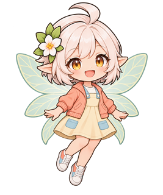
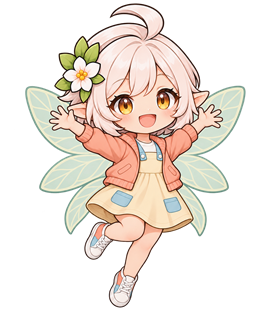
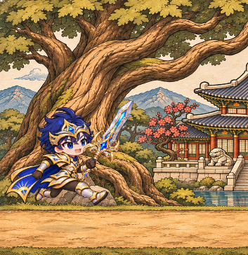
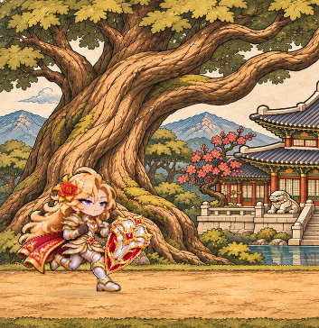
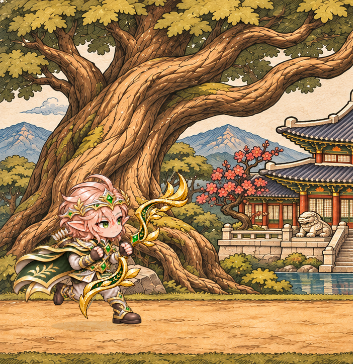
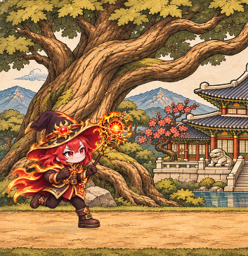
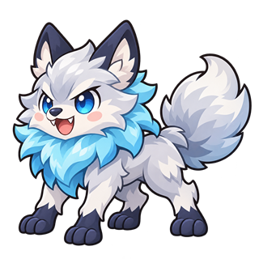
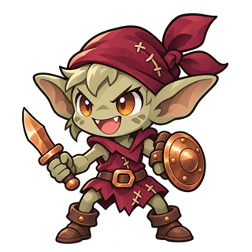
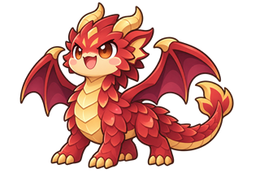
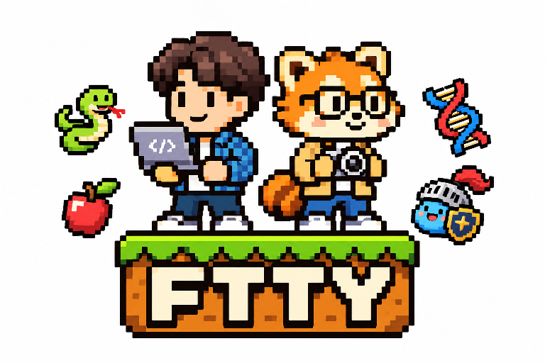

# 던전런

달린 거리가 모험이 되는, 루미와 함께하는 스마트폰 중심 러닝 RPG입니다. 현실에서 달리며 몬스터와 싸우고 동료를 만나 보세요.

[GitHub Pages로 웹사이트 보기](https://eugeneahn777.github.io/dungeon-run-showcase/)

웹사이트에서 네 모험가와 함께 가상의 2km 여정을 체험해 보세요. 같은 장면에서 달리기, 슬라임과의 전투, 직업별 타이틀과 효과가 더해진 자동 필살기, 승리와 다시 달리기로 이어집니다. 시연에서는 모험가의 빨간 하트와 슬라임의 파란 하트가 각각 세 개로 시작합니다. 루미의 짧은 응원 음성 세 가지도 들어 볼 수 있습니다.

## 소개 사이트 사용법

1. [가상 여정](https://eugeneahn777.github.io/dungeon-run-showcase/#adventure)으로 이동하고, 모험가 구역에서 검사·방패전사·엘프·마법사 중 한 명을 선택합니다.
2. 슬라이더를 움직여 0~2km의 진행 거리, 남은 거리와 진행률을 살펴보세요. 자동 재생, 일시 정지, 처음으로 버튼도 이용할 수 있습니다.
3. **전투 장면 보기**를 누르면 거리를 바꾸지 않고 시간을 압축한 전투를 볼 수 있습니다. 실제 앱에서는 한 전투의 유효거리 100m에 필살기가 자동 발동합니다.
4. 루미 구역에서 **루미의 응원 받기**를 누르면 AI 생성 응원 음성 세 가지가 클릭할 때마다 차례로 재생됩니다. **음성 정지**와 **음소거**도 선택할 수 있습니다.
5. **움직임 줄이기**를 켜면 자동 재생은 사용할 수 없고, **전투 단계 보기**를 눌러 장면을 하나씩 살펴볼 수 있습니다.

이 사이트는 소개용 가상 체험으로, 실제 GPS 측정이나 보상·기록 저장·소유 변경을 하지 않으며 설치 파일을 제공하지 않습니다.

## 달리며 이어 가는 모험

- 실제 달린 거리로 여정을 이어 가고, 경험치나 레벨 대신 러닝 기록과 등급, 칭호를 쌓습니다. 루미의 목소리도 달리는 길에 함께합니다.
- 달리는 장면에서 하트로 몬스터와 전투합니다. 한 전투에서 유효거리 100m를 달리면 필살기가 자동 발동합니다. 14종의 몬스터를 만날 수 있습니다.
- 검사로 시작해 각 단계의 모험가로 한 번에 5km 이상 달리기를 마치고 저장하면 방패전사, 엘프, 마법사가 차례로 동료가 됩니다.
- 60종의 장비 중 자격에 맞는 무기와 의상을 구매하고 직접 착용해 모험가를 꾸밉니다.
- 서울을 바탕으로 한 6개 게임 권역과 12개 랜드마크를 탐험하고, 캘린더와 러닝 일기로 달린 날을 돌아봅니다. 권역은 게임용 근사 구분이며 길 안내 기능은 아닙니다.

## 러닝 파트너 루미

루미는 달리는 길에 함께하는 요정입니다. 출발과 달린 거리, 목표, GPS 상태를 목소리로 알려 주고 몬스터와 전투 상황에 맞춰 응원합니다. 새 전투에서 하트가 다시 채워지는 장면도 함께하며, 여섯 가지 의상으로 꾸밀 수 있습니다.

| 함께하는 루미 | 응원하는 루미 |
| --- | --- |
|  |  |

## 모험가 예시

| 검사 | 방패전사 |
| --- | --- |
|  |  |

| 엘프 | 마법사 |
| --- | --- |
|  |  |

## 대표 몬스터

| 물방울 슬라임 · 첫 만남 | 서리갈기 늑대 |
| --- | --- |
|  |  |

| 잿빛 장난꾼 고블린 | 홍련비늘 용 · 주말 레어 |
| --- | --- |
|  |  |

## 제작팀

던전런 제작팀 FTTY의 로고입니다.

### 개발자 · ISTP: 친구의 상상을 코드로

기획자 친구의 상상을 코드로 바꾸는 사람. 의심이 많아서 먼저 돌려 보고, 성격이 급해서 바로 배포한다.

**꿈의 스케일: 100만 다운로드** — 자기 이름을 건 서비스 하나가 대박 나는 것. 던전런으로 그 꿈을 향해 달립니다.

### 기획자 · INFP: 환생연애 출연 지망생

‘환생연애’ 출연이 꿈인 기획자. 아무래도 연애보다 렛서판다로 환생하는 쪽에 더 진심인 것 같습니다.

**꿈의 스케일: 서울대공원 연간회원권** — 오타쿠 러너들의 피·땀·눈물·골수를 쪽쪽 빨아들여 서울대공원 연간회원권을 마련하는 것.

골수까지는 안 받습니다. 여러분은 오래오래 건강하게 달려주셔야 하니까요.

위 이미지는 시각 참고용으로 실제 기기 화면과 다를 수 있습니다.

이 소개에는 축소된 예시 이미지와 짧은 음성만 사용합니다. 원본 그림·음성·개발 지시서는 별도 비공개로 관리하며, 예시 열람은 원본 자산의 재배포 권한을 부여하지 않습니다.
